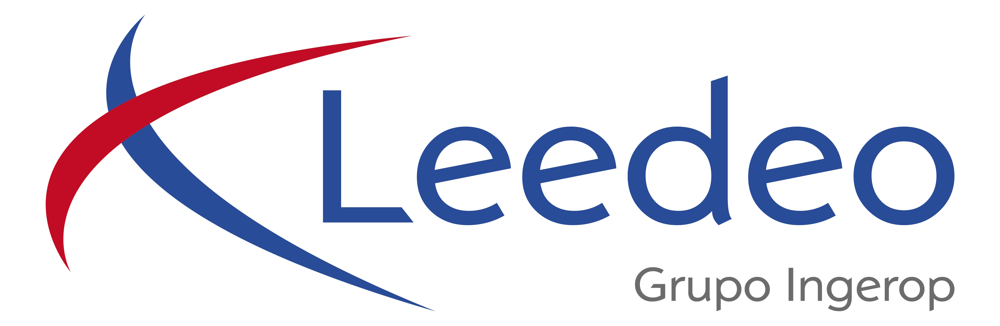

# leedeo-filestore Project Overview

Prepared by Xavi Arnal, 10 Jul 2026

## Who we are

**Leedeo Engineering** is a RAMS engineering consultancy working primarily in the railway sector. We are a subsidiary of Ingerop Spain (itself part of the Ingerop group). Our core work is safety and reliability engineering for railway systems - analysis, documentation, and certification work that generates and consumes large volumes of technical standards, project specifications, and internal documents.

The software team at Leedeo is developing AI tooling to support these RAMS workflows, the goal being to give engineers access to their document collections through LLM-based tools - without handing documents over to a third party or losing control over what the model can access.

## What this project is

**leedeo-filestore** is an internal server, developed at Leedeo, that gives LLM-based tools structured, controlled access to named document collections ("filestores"). Two interfaces are exposed, an MCP server used by AI tools to interact with these filestores, and a companion REST API for administrative management of these collections.

The project is currently deployed on Ingerop's internal network, accessible within the Ingerop Spain virtual network. The server holds no LLM or inference capability of its own, it is purely a document access layer.

## Network access model

The server is already in testing within the company network. Claude Desktop (used for testing, with fake data) connects to it directly from the user's machine, meaning MCP calls never leave the corporate network.

Whether an externally accessible port is needed depends entirely on which AI tools are in use. Some services (the obvious counterpart being claude.ai) make MCP calls from their own servers rather than from the user's machine, which would require the MCP server to be internet-reachable. This is not a property of MCP itself, it is a service-specific architectural choice. Any tool that issues MCP calls from the client side (the user's machine or a machine within the company network) works with the current internal-only deployment.

How to interpret this thus depends on the particular tool that will be using this server:

- **Custom internal solution.** We have a web-based client in development (with the strict intent to use LLM compute in EU datacenters). Because it would call the server from within the network, it similarly requires no external exposure.
- **Delos.** The ChatGPT-style tool that the company is in the process of adopting. Whether Delos supports arbitrary MCP connectors at all is currently unclear, we would need to verify this before deciding whether external access is a requirement.

A request for port forwarding (to a non-standard port in the 81xx range) has been submitted to IT, but the internal deployment is functional regardless.

## Capability tiers

Ordered by assumed risk. Tiers 1 & 2 are already implemented and deployed, tier 3 is awaiting IT authorization, tier 4 is under consideration.

### 1. Read-only access to regulation filestores

The server hosts collections of technical standards (CENELEC railway standards and similar). LLM tools can read these documents and run semantic search ("find me the relevant sections on this topic") over them.

All operations against these filestores are read-only at the protocol level. The documents themselves are publicly available standards, not internal company data. Even in the event of unauthorized access, there is no company-confidential material to expose.

### 2. Ephemeral personal filestores

Users can provision temporary working collections (scratch spaces for an AI-assisted workflow) which are deleted on demand. These are blank by default: nothing company-sensitive exists in them unless the user deliberately puts it there. Any data that could "leak out" must have come in from outside first, making this comparable in risk profile to any shared file storage service.

Access control is enforced per-request: filestores are private to their owner unless explicitly marked shared.

### 3. Read-only SharePoint / OneDrive access via Microsoft Graph

This capability would allow LLM tools to read (not modify) SharePoint document libraries on behalf of the authenticated user. The design intent is delegated OAuth only, meaning that the server acts as the user, using their own Microsoft identity and permissions - no access to anything the user couldn't reach directly.

This tier requires an Azure AD app registration and formal authorization from IT. The infrastructure for it (the authentication layer, the file port interface) is designed and in place; the Graph adapter itself has not been built yet.

### 4. Write access to SharePoint

Completeness requires acknowledging this possibility, but it is not a near-term plan and would require explicit policy authorization, independent of anything in Tier 3. The same delegated-auth model would apply.

## Current security model

- All requests require a bearer token. There is no unauthenticated access to anything.
- Current mechanism: API keys, one per user account, managed server-side. Each request is resolved to a user identity before any operation is allowed.
- Planned prod mechanism: Microsoft OAuth (delegated access via Azure AD). This replaces the API key stand-in without changing the shape of the auth layer: the token becomes the user's MS OAuth token instead of a static key, and Graph API calls are made on the user's behalf using that token.
- Access control is enforced per request: filestore-level read-only flags block all write operations, owner/shared flags control visibility between users.
- The local development (stdio) transport is never exposed over a network.

## IT / infrastructure dependencies

There are three areas that may require coordination as the project evolves:

### 1. Azure AD app registration (MS OAuth)
Production authentication will use Microsoft OAuth delegated access, users authenticate with their Microsoft identity rather than a static API key. This requires registering an application in Azure Active Directory. We would work with the relevant IT contact to get this set up, the server-side integration is already designed around this model.

### 2. SharePoint / Microsoft Graph access (Tier 3 and above)
Read access to SharePoint document libraries via the Graph API requires that the Azure AD app registration include the relevant Graph API permissions, and that those permissions be authorized by IT. We would not make Graph API calls to any document library without explicit authorization scoping - the delegated model means the app can only access what the user's own account can access, and the permissions must still be granted at the app-registration level.

### 3. MCP server framework
The MCP (Model Context Protocol) server pattern (exposing structured tool interfaces to LLM hosts) is likely to be a recurring infrastructure pattern across multiple teams. We are interested in contributing to any internal framework being developed for MCP server deployment or governance, whether for internal or externally-accessible services.
